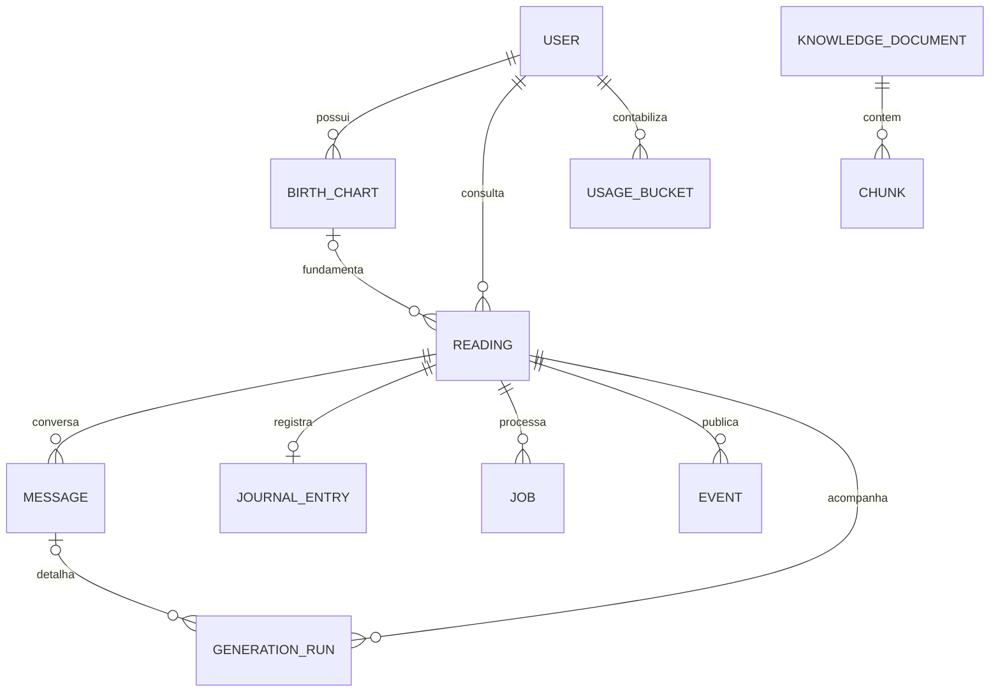

# Modelo de dados — Arcana

15 entidades. Esquema definido em app/db/models.py, aplicado pelas migrações Alembic.

Reading.chart_id/user_id referencia BirthChart.id/user_id: não admite mapa de outro usuário.
Snapshots ficam em Reading.facts. Chart_id pode ser nulo em tarot ou em registros legados
cujo mapa já não exista; novos pedidos astrológicos exigem mapa válido.

KnowledgeDocument identifica uma versão de fonte/tópico, com licença e hash do conteúdo.
Chunk tem documento obrigatório e posição única. Versões antigas mantêm seus trechos e
vetores; apenas a versão ativa participa da busca. A ingestão rejeita mudanças na mesma
versão. Citações históricas continuam armazenadas com seu texto na interpretação.

AuthSession, ResetToken, Mail e RateBucket completam as 15 entidades de infraestrutura.
Cartas permanecem no catálogo em código e são copiadas no snapshot da tiragem.

UsageBucket tem chave usuário/dia UTC/tipo; excluir leitura não apaga consumo.
Message possui sequência única por leitura. GenerationRun inclui erro, tokens de chat e
embeddings, modelo e modo de recuperação; Chunk registra o modelo do vetor quando conhecido.
